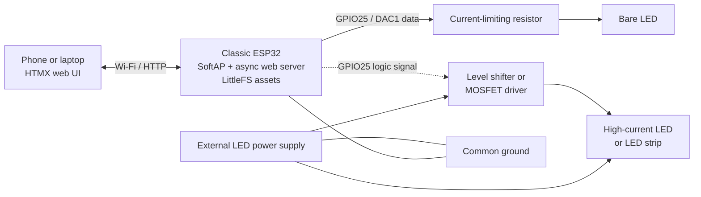

# ESP32 LED Controller

A small htmx-based web UI for a classic ESP32. It provides:

- On/off control
- Solid/blink mode
- A blink-delay slider shown only in blink mode
- Small HTML responses from the ESP32 for fast command acknowledgement

The LED output uses the ESP32's DAC1 on **GPIO25**. Connect an LED through a suitable current-limiting resistor. For a high-power LED or LED strip, use GPIO25 to drive an appropriate transistor/MOSFET circuit instead of driving the load directly. GPIO26 (DAC2) is also available on classic ESP32 boards, but is not used here.

This targets the classic `esp32dev` board. ESP32-C3, S2, and S3 variants do not have the same DAC pins and need a different output implementation.

## System architecture and wiring



For the simplest single-LED setup, wire **GPIO25 → current-limiting resistor → LED anode**, then connect the LED cathode to **GND**. Do not power an LED strip or high-current LED from the ESP32 pin. Use GPIO25 only as the control signal for a suitable transistor/MOSFET driver; add a level shifter if the selected driver or LED hardware requires a higher logic level, and tie the external supply ground to ESP32 ground.

## Web UI

The browser interface is served from the ESP32's LittleFS filesystem and uses htmx to exchange small HTML fragments rather than reloading the page.

```text
┌──────────────────────── LED Controller ────────────────────────┐
│ Commands are applied to the physical LED immediately.          │
│                                                                │
│ [ ] LED enabled                                                │
│                                                                │
│ Mode:  (●) Solid   ( ) Blink                                   │
│         Blink mode reveals a 50–2000 ms delay slider.          │
│                                                                │
│ Status: LED on / LED off / Blink delay set                     │
└────────────────────────────────────────────────────────────────┘
```

## Build in Docker

Docker and GNU Make are required. All build output is bind-mounted into this project:

```sh
make test          # asset checks and a debug firmware build
make build         # release build (default)
make build debug   # debug build
make build release # release build
```

Equivalent profile syntax is also supported:

```sh
make build PROFILE=debug
```

The first build downloads the PlatformIO toolchain and libraries. They are cached in `build-cache/platformio/`. Firmware and filesystem artifacts are left in `.pio/build/<profile>/`, including:

```text
.pio/build/release/firmware.bin
.pio/build/release/littlefs.bin
```

The web assets are in `data/`; `littlefs.bin` is produced when the filesystem is built or uploaded.

## Local UI preview

Run the standard-library mock server from the project directory:

```sh
make preview
```

Then open <http://127.0.0.1:8080/>. The preview serves the production assets from `data/` and handles the htmx POST endpoints locally, so the power switch, mode controls, conditional blink slider, and status fragments can be exercised without an ESP32. Set another port with `PORT=9090 make preview`.

## Engineering & CI Highlights

- **Reproducible containerized toolchain:** the Docker image fixes the PlatformIO build environment, while the Make targets mount source, cache, and output directories so local development and CI use the same commands and produce inspectable firmware/filesystem artifacts.
- **Automated verification:** pull requests and `main` updates run content linting, web asset tests, a debug firmware build, and a LittleFS build.
- **Workflow supply-chain hardening:** third-party GitHub Actions are pinned to full commit SHAs, checkout credentials are not persisted, and workflow permissions are reduced to the access each job needs.
- **Workflow security analysis:** [`zizmor`](https://github.com/woodruffw/zizmor) audits the GitHub Actions configuration before build and release jobs run.
- **Release artifacts:** semantic version tags build and publish versioned `firmware.bin` and `littlefs.bin` files with SHA-256 checksums.

## Flashing

1. Connect the ESP32 over USB and identify the serial port, commonly `/dev/ttyUSB0` or `/dev/ttyACM0`.
2. Build the firmware and filesystem:

   ```sh
   make build
   docker run --rm -u "$(id -u):$(id -g)" \
     -v "$PWD:/workspace" \
     -v "$PWD/build-cache/platformio:/opt/platformio" \
     -w /workspace esp32-led-controller-builder:local \
     run -e release -t buildfs
   ```

   `buildfs` creates `littlefs.bin`. If the image does not exist yet, run `make build` first.
3. Flash firmware and the web filesystem (replace the port if necessary):

   ```sh
   make flash PORT=/dev/ttyUSB0
   make flashfs PORT=/dev/ttyUSB0
   ```

   These targets pass `/dev` into a privileged, temporary container. On some systems the board must be placed in download mode by holding **BOOT**, tapping **EN/RESET**, then releasing **BOOT** when upload starts.
4. Open the serial monitor if desired:

   ```sh
   make monitor PORT=/dev/ttyUSB0
   ```

5. Connect your computer or phone to the Wi-Fi network `ESP32-LED` with password `esp32-led`, then browse to `http://192.168.4.1/`. Change the SSID and password in `src/main.cpp` for deployment.

### Manual PlatformIO commands

The container is also available directly:

```sh
docker run --rm -it --privileged --user root \
  -v "$PWD:/workspace" \
  -v "$PWD/build-cache/platformio:/opt/platformio" \
  -v /dev:/dev -w /workspace \
  esp32-led-controller-builder:local \
  run -e release -t upload --upload-port /dev/ttyUSB0
```

## Hardware notes

- GPIO25 is DAC1 and outputs 0–3.3 V approximately using an 8-bit value.
- This project uses DAC values 0 and 255 for off/on and uses software timing for blinking.
- Always include a current-limiting resistor for a bare LED.
- The LED's physical state is the primary feedback. The web UI only reports that the ESP32 accepted a command.
